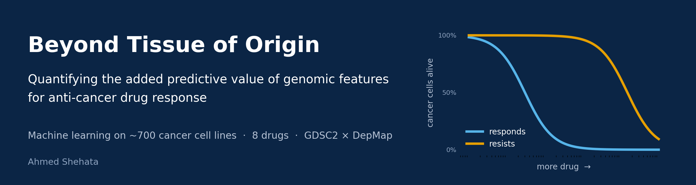
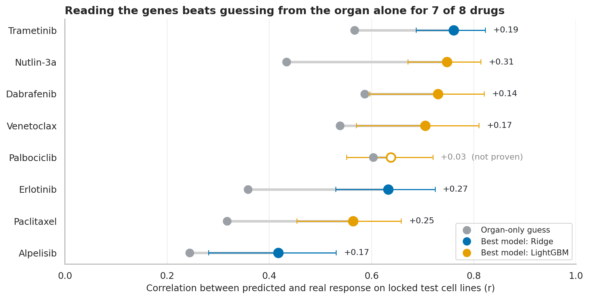
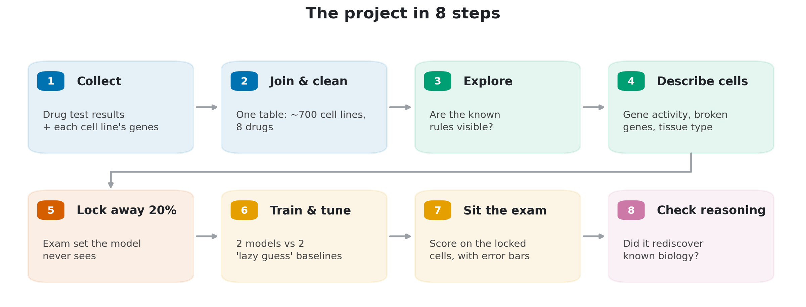
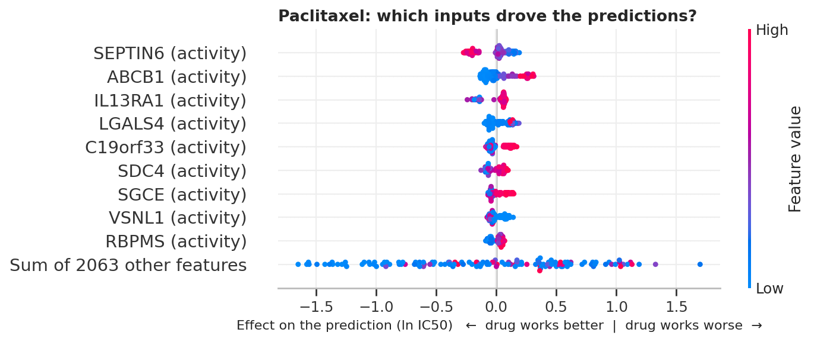

# Beyond Tissue of Origin: Quantifying the Added Predictive Value of Genomic Features for Anti-Cancer Drug Response

**An end-to-end machine-learning study of 8 cancer drugs across ~700 cancer cell lines**, joining the two largest public resources for this question: **GDSC** (drug tests, Wellcome Sanger Institute) and **DepMap** (cell genetics, Broad Institute).


**[Open the notebook](pharmacogenomic_drug_response_predictor.ipynb)** (or [view it on nbviewer](https://nbviewer.org/github/AhmedShehata2002/beyond-tissue-of-origin/blob/main/pharmacogenomic_drug_response_predictor.ipynb) if GitHub is slow to render it). It is written so that anyone with a university background can follow it, with no biology or data-science knowledge needed. The technical detail sits in expandable sections.

---

## The question

Most cancer drugs help only a minority of the patients who receive them, and for most drugs there is no test that tells doctors in advance *who* will benefit. This project asks:

> **If we read a cancer's genes, can we predict how well a specific drug will work on it, better than just knowing which organ the cancer came from?**

## The result



Scores are measured on ~140 cancer cell lines that were **locked away before any training**:

- **Genes beat the organ-only guess for 7 of 8 drugs.** Correlations between predicted and real drug response reach 0.42–0.76, and the improvement holds up under bootstrap confidence intervals.
- **The models rediscovered known biology without being told.** Among ~2,070 inputs, the textbook gene came out as the #1 input for dabrafenib (*BRAF*), Nutlin-3a (*TP53*) and venetoclax (*BCL2*). For the chemotherapy drug paclitaxel, the model found ***ABCB1***, a pump cancer cells use to push the drug back out.
- **The signal holds for a yes/no question too.** Asked to flag which cell lines are sensitive to each drug, gene-based models score AUC 0.67–0.92 against 0.56–0.85 for the organ-only guess, higher for every drug.
- **The failures are informative too.** A real but rare genetic rule (*EGFR* for erlotinib, 19 of ~700 lines) can't be learned. For palbociclib, the organ of origin explains most of what's predictable.

| Drug | Organ-only guess (r) | Best gene-based model (r) | Genes add real value? |
|---|:---:|:---:|:---:|
| Dabrafenib | 0.59 | **0.73** | Yes |
| Trametinib | 0.57 | **0.76** | Yes |
| Erlotinib | 0.36 | **0.63** | Yes |
| Alpelisib | 0.24 | **0.42** | Yes |
| Nutlin-3a | 0.43 | **0.75** | Yes |
| Venetoclax | 0.54 | **0.70** | Yes |
| Palbociclib | 0.60 | 0.64 | Not proven |
| Paclitaxel | 0.32 | **0.56** | Yes |

## How it works



**What makes the method trustworthy:**

- **A locked test set.** 20% of cell lines are set aside before any learning happens and scored exactly once. All tuning happens in 5-fold cross-validation inside the training set.
- **No leakage.** Gene selection (unsupervised, by variance), scaling and tuning all happen inside training folds only.
- **An honest bar to beat.** Models are compared against an organ-of-origin baseline, not just the average, because a doctor always knows the organ.
- **Uncertainty reported.** Bootstrap 95% intervals are given on every score, plus a paired test of the gain over the baseline.
- **A reasoning check.** SHAP explanations are compared against an answer key of known biomarkers, with one negative-control drug.
- **Robustness.** Results are stable when the number of genes is changed (500 / 2,000 / 5,000), and there is no sign of overfitting when training and test errors are compared.
- **A decision log.** Every choice is listed, with the alternatives that were rejected.

<p align="center"></p>

## Repository

```
├── pharmacogenomic_drug_response_predictor.ipynb   ← the full analysis (executed, with all outputs)
├── images/                                          ← diagrams and key result figures
├── scripts/make_diagrams.py                         ← regenerates the explanatory diagrams
├── requirements.txt
├── LICENSE
└── data/                                            ← not included (see below)
```

## Reproduce

```bash
pip install -r requirements.txt
```

Download these five files into `data/`:

| File | Source |
|---|---|
| `GDSC2_fitted_dose_response_27Oct23.xlsx` | [GDSC bulk download](https://www.cancerrxgene.org/downloads/bulk_download) or [Cell Model Passports](https://cellmodelpassports.sanger.ac.uk/downloads) (GDSC2, Release 8.5) |
| `Model.csv` | [DepMap downloads](https://depmap.org/portal/download/all/) (latest DepMap Public release; this analysis used the files available on 26 Sep 2026) |
| `OmicsExpressionTPMLogp1HumanProteinCodingGenes.csv` | DepMap |
| `OmicsSomaticMutationsMatrixDamaging.csv` | DepMap |
| `OmicsSomaticMutationsMatrixHotspot.csv` | DepMap |

Then run the notebook top to bottom. It takes about 45 minutes on 2 CPU cores, and less on a typical laptop. With the same data and seed, the numbers reproduce exactly.

## Limitations

These are cancer **cell lines**, not patients, and lab drug response is not clinical outcome. The drugs were chosen *because* they have known biomarkers, so the scores are an upper end rather than typical. See the notebook for the full list and next steps: all ~290 drugs, a model that generalizes to new drugs, and validation on patient tumours.

## Data & acknowledgements

Drug-response data: Genomics of Drug Sensitivity in Cancer (Wellcome Sanger Institute). Cell-line genetics: DepMap (Broad Institute). Both are used under their respective terms of use. The raw data is not redistributed here.

## Author

**Ahmed Shehata**. MSc Health Data Science, University of Birmingham (in progress); Medical Sciences, Oxford Brookes University.

[GitHub](https://github.com/AhmedShehata2002) · [LinkedIn](https://www.linkedin.com/in/shehata-ahmed) · [Portfolio](https://www.datascienceportfol.io/ahmedshehata)

## License

The code in this repository is released under the [MIT License](LICENSE). The GDSC and DepMap data are **not** covered by this licence and are not included; they remain subject to their providers' terms of use.
